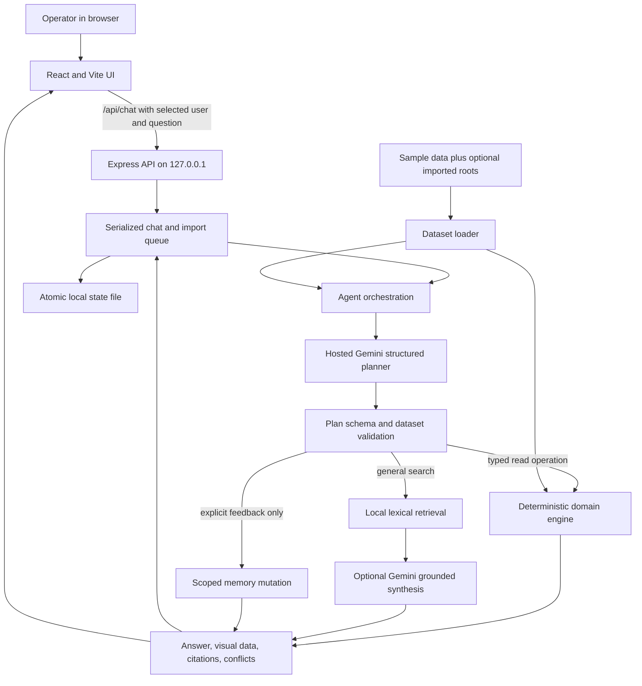

# Architecture

This document describes the local demo in `apps/asset-intelligence-copilot`. The browser and Express service run on the same machine. Dataset reads and copilot persistence stay local; model planning and evidence synthesis use the hosted Gemini API when configured.

## Request flow



The hosted planner receives the question, reference date, compact area/well context, selected user identity, and up to five bounded history entries for that user; it returns a JSON `QueryPlan` from the finite operation schema in `server/plan.ts` and `server/agent.ts`. The server validates the operation and its IDs, dates, area, well type, equipment, value types, and visual before execution. A cached plan is reused only for the same dataset, reference date, question, state revision, and user history; the answer is recomputed. If Gemini is unavailable or returns an invalid plan, `inferPlan` provides a local fallback.

Typed operations include status, area status, temperature history, spills, downtime and ranking, heatmap, compliance, containment, RCA, costs, shared knowledge, search, and explicit correction/rule/note/claim writes. Domain operations calculate locally and return their answer, citations, conflicts, and optional visual directly. They do not ask Gemini to recalculate numeric results.

Containment reports count candidate spills, resolved timings, within-limit cases, breaches, missing reports, and reports with unusable timing. Compliance also reports candidate spills, resolved timing, missing reports, unparsed timing, and unknown volumes. Their answer text discloses incomplete evidence; when a visualization is returned, its coverage metadata also records the observation range and dataset as-of date.

General search builds a lexical term index over the loaded documents, scopes results by parsed IDs/area/type/date when available, and selects at most six evidence passages. For non-aggregate questions, Gemini may synthesize prose from those passages. Ordinary one-document synthesis uses the primary model (`gemini-3.5-flash-lite` by default). In the default `auto` route, the optional reasoning model is used only for explicit deep-analysis requests or comparisons/conflicts across multiple retrieved documents. `GEMINI_SYNTHESIS_REASONING=always|never` can override the route for eligible synthesis requests. Synthesis returns text segments, each with source IDs. The server validates each segment against its selected passages, rejects unsupported numeric tokens and record/protocol IDs, and renders the citations itself. These guards establish identifier membership and numeric-token support, not semantic entailment. Aggregate requests without a typed operation return evidence without model arithmetic.

## Data loading and evidence

`server/data.ts` reads `fleet/` and `assets/` data: JSON and JSONL records, well-type manuals, SOPs, and report files referenced by maintenance records. The loader accepts a dataset root containing `fleet/` and `assets/`, or a parent containing `sample-data/` or `test-data/`. The default root is the repository's `sample-data/`; `SAMPLE_DATA_PATH` can override it.

The local importer adds a same-format folder alongside the default sample and saves the selected root. Records merge by their record IDs; when IDs collide, the later root replaces the complete record. Omitted fields are not borrowed from the prior record, and records absent from the later root remain in the merged dataset. A replacement repair invalidates its previous report even when the new `report_file` is absent or unreadable. A readable report is loaded only through that repair's `report_file` path. This does not write to either dataset folder. Evidence documents merge by type plus record ID, so a structured repair and its free-text repair report remain distinct despite sharing a maintenance ID. Citations retain the originating root and relative source path.

The reference date is fixed to `2026-10-16` by default for challenge evaluation. `REFERENCE_DATE` or the import dialog can set it explicitly; the selected value is persisted. Without an explicit reference date, the loader infers one day after the latest inspection date. Keep three dates distinct: the dataset reference/as-of date controls what the demo treats as current; source observation dates such as `inspected_at` and event dates describe when evidence occurred; feedback `createdAt` describes when a user entered a correction or note. Effective dates such as `valid_from`/`valid_to` govern when a contextual note applies. Historical status uses the selected inspection date as its context and does not compare the old reading to today's status.

Production status compares wellhead and ambient temperature using the applicable manual. Formal corrections are shared and applied to the named inspection while preserving the raw value, author, timestamp, and reason. Downtime uses seven days per non-producing weekly inspection; missed inspections contribute no downtime. Repairs, regulator events, notes, manuals, SOPs, and repair reports are linked by IDs for evidence selection.

## Shared state and private history

`server/engine.ts` defines shared corrections, shared well/type facts, unconfirmed claims, and type-specific rules separately from `history[userId]`. A feedback write must come from an explicit declarative message. Read-only and explicitly hypothetical questions are routed away from write operations; a model-generated plan cannot invent write payloads. Inspection corrections preserve the original and corrected value and are applied across users. Claims remain unconfirmed, and disagreements are surfaced. Type rules are scoped to a well type and equipment kind.

The API serializes chat and dataset import transactions. For chat, it clones candidate state, runs the agent, appends the response to that user's history (up to 80 entries), writes a temporary state file, renames it to `.local/state.json`, and only then swaps the in-memory state. This avoids exposing a partially written state file. The `COPILOT_STATE_DIR` variable can relocate this folder.

The user picker selects a user from the challenge dataset; the selected ID is stored in browser `localStorage`. The service checks that the ID exists in the loaded dataset, but this is a demo switcher, not authentication or authorization. Do not treat it as production identity or access control.

## API and UI

The Express service exposes local endpoints for health and bootstrap data, per-user history and memory, source evidence lookup, chat, dataset loading, and result export. It binds to `127.0.0.1` and restricts browser API origins to local hosts. Vite proxies `/api` to the API port during development.

`src/App.tsx` owns the chat, user picker, import flow, source library, citation drawer, and memory drawer. Answers use the typed contract in `src/contracts.ts`; `src/VisualBlock.tsx` renders the six supported visual types: status, table, line, bar, map, and heatmap. Large status, table, heatmap, bar, and map-record lists use page controls; source collections and map record lists can be filtered. A map filter applies to its record list, while the plotted coordinates remain visible. The map view plots supplied coordinates on a local grid and has no external basemap. Inspection images are not available in the sample data and are not analyzed.

## Hosted Gemini and quota handling

`server/gemini.ts` calls the Gemini `generateContent` endpoint using server-side `fetch`; API keys are not sent to browser code and provider error bodies are not returned to users. This app has no local-model implementation.

Configuration is read from `.env.local` or `.env` in the app directory. The app does not use local models. Planning context includes only five bounded exchanges attached to the selected user. General search synthesis receives up to six bounded retrieved source passages. `GEMINI_API_KEYS` accepts a JSON array or a comma/newline-separated list. In this deployment each string entry maps to an independent application-side bucket; entries for one shared project can use matching `projectId` metadata to share that bucket. The optional single-key `GEMINI_API_KEY` is supported too. These buckets, queues, counters, and cooldowns live in this server process; they are not aggregate across processes and do not guarantee or report upstream Google project quotas.

The planner and ordinary one-document synthesis use `GEMINI_MODEL`, which defaults to `gemini-3.5-flash-lite`. In `auto` mode, `GEMINI_REASONING_MODEL`, when configured, is selected only for explicit deep analysis or comparisons/conflicts across multiple retrieved documents. `GEMINI_SYNTHESIS_REASONING=auto|always|never` selects default routing or overrides it for eligible synthesis requests. If reasoning is requested without a reasoning model configured, the primary model is used. `GEMINI_FALLBACK_MODEL` can provide an alternate when the selected model is unavailable. The process-local application caps default to 5 requests/minute, 20,000 tokens/minute, and 100 requests/day per bucket, with a 25-second timeout and at most two provider attempts. They are not aggregate or authoritative Google project quotas. Actual Gemini limits are project-level and vary; check them in Google AI Studio. Daily reset and conservative daily quota cooldown follow midnight America/Los_Angeles.

The full list of environment variables and local commands is in [README](../README.md). Never commit `.env.local`; it is listed in the app `.gitignore`.

## Checks and limits

From the app directory, after `npm install`, run the deterministic checks with:

```powershell
npx tsx scripts/acceptance.ts
npx tsx scripts/data-check.ts
```

The acceptance suite documents challenge-question behavior in [ACCEPTANCE.md](ACCEPTANCE.md). Recorded local evidence is 109/109 domain stress cases in [DOMAIN_STRESS.md](DOMAIN_STRESS.md), 27/27 provider stress checks in [PROVIDER_STRESS.md](PROVIDER_STRESS.md), 22/22 synthetic data-readiness cases in [FINAL_DATA_READINESS.md](FINAL_DATA_READINESS.md), and 12 deterministic UI render checks in [UI_STRESS.md](UI_STRESS.md). These reports document their own scope; none establishes hidden-final-dataset acceptance. The 32-scenario hosted initial run was 29/32 on semantic checks and 27/32 hosted-plus-semantic. A focused retest passed the three answer defects; across runs, semantic checks are 32/32 and hosted-plus-semantic is 30/32. Two remaining hosted-path misses were correctly rejected by deterministic fallback but remain hosted reliability failures. This was not a fresh complete 32-scenario run after the fixes. The report records 39 HTTP 200 responses, 69,670 reported tokens, and no retries or cooldowns. See [UNSEEN_LIVE_CHECKS.md](UNSEEN_LIVE_CHECKS.md) and [LIVE_CHECKS.md](LIVE_CHECKS.md) for the evidence; these results do not establish an aggregate all-scenario pass. Local review evidence and its limits are recorded in [REVIEW.md](REVIEW.md). Architecture decisions cross-checked against the code and local records are in [RESEARCH_APPLIED.md](RESEARCH_APPLIED.md). See [DELIVERY.md](DELIVERY.md) for the final build and browser evidence. Public deployment, repository publication and OrganizerHQ submission remain outstanding. The data is synthetic, no photos are supplied, and this demo's user picker is not production authentication. A passing local check is not a guarantee of a judging outcome.

