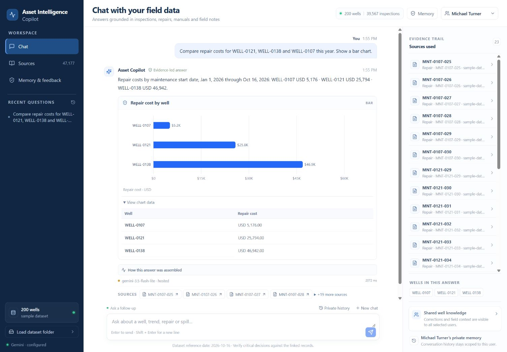

# Local build delivery

**Submission checkpoint: 17 October 2026, approximately 2:26 PM IST.** OrganizerHQ saved Level 1 submission v1, ID `sub_BGC6l8zU`. The public authored repository is [GODOSTROYER/flytbase-asset-intelligence-copilot](https://github.com/GODOSTROYER/flytbase-asset-intelligence-copilot), verified at commit `2a37658038c8c8ef28f30f06c7e004607faf696f`. See the [submission receipt](SUBMISSION_RECEIPT.md) for links, uploaded ZIP identity and the continuation. Final event answers and the entrant's own-voice replacement remain pending; the saved video uses disclosed AI narration.

Original build checkpoint: 17 October 2026, 1:56 PM IST. The application is implemented and running locally at `http://127.0.0.1:4178`. The production build, provider citation check and built-interface browser check passed at that checkpoint.

Follow-up checkpoint: 17 October 2026, 2:23 PM IST. Independent stress and unseen-question evidence is summarized below. A separate browser smoke check found that an explicit fleet-wide non-producing-well list incorrectly selected downtime leaders. The fix and retained fleet/area/type regression passed. Root's hosted UI retest returned all 15 current non-producing wells; changing to ten rows per page showed 1–10 of 15, then Next showed 11–15 of 15 with the expected final five IDs. This is separate from the 32-case unseen batch. OrganizerHQ submission is still pending.

## Open and run

App directory: `Z:\Projects\MLH  Hackathon\flytbase-ahc-swe-asset-intelligence-dataset\apps\asset-intelligence-copilot`.

```powershell
npm run build
npm start
```

Built interface: `http://127.0.0.1:4178`. Development command: `npm run dev`, with the UI normally at `http://127.0.0.1:5173`.

Local branch: `codex/asset-intelligence-copilot`. No commit or push has been made. The Git remote belongs to the upstream challenge dataset repository.

## Architecture and implemented scope

- Hosted Gemini returns a validated, typed query plan. Deterministic tools compute status, downtime, spill volume, repair costs and compliance from the loaded records.
- General document questions retrieve bounded source passages for hosted synthesis. Unsupported aggregates return evidence with an explicit limitation. Provider failure returns labeled deterministic results or original source passages.
- The server cycles across the user's five independent Gemini projects, with separate request/token/day controls and cooldowns. Keys stay in the ignored server-side `.env.local`. No local model is used.
- Shared corrections preserve original values, author, reason and scope. Notes and unconfirmed claims remain distinct from corrections. Private history is retrieved only for the selected dataset user.
- The UI provides status, table, line, bar, coordinate-map and heatmap views, original-source inspection, memory inspection, user switching and same-format dataset import.
- Chat/import writes are serialized and saved atomically. Import errors retain the previous dataset and state; overlapping IDs merge without modifying source files.

See [Architecture](ARCHITECTURE.md), [README](../README.md), and [design comparison](../design/IMPLEMENTATION.md).

## Evidence

| Check | Recorded outcome |
|---|---|
| Challenge scenario checks | 25/25 passed; see [ACCEPTANCE](ACCEPTANCE.md). |
| Independent domain probes | 13 passed. |
| Dataset importer | 10 passed. |
| Domain stress | 109/109 passed after retaining and fixing 11 initial failures; see [DOMAIN_STRESS](DOMAIN_STRESS.md). |
| Provider/planner stress | 27 offline checks passed, plus the separate fleet/area/type current-status regression with genuine downtime preserved. See [PROVIDER_STRESS](PROVIDER_STRESS.md) and `scripts/provider-current-status-check.ts`. |
| Ingestion stress | 22/22 passed, including complete-record replacement, report provenance, malformed imports and correction conflicts; see [FINAL_DATA_READINESS](FINAL_DATA_READINESS.md). |
| Persisted API behavior | Seven grouped checks passed, including concurrency, restart recovery, privacy, corrections and import rollback. |
| Provider scheduling | Eight offline checks passed for project grouping, caps, round robin, cooldown/fallback, deadlines and queueing. |
| Synthesis validation | Nine independent checks passed, including unknown source/record/protocol rejection and per-segment numeric support; zero cloud requests in this check. These guards do not prove semantic entailment. |
| Explicit visualization requests | 11 targeted checks passed, including exact USD bar values and table override. |
| Hosted Gemini | Passing evidence for 14 representative cases across the initial run and targeted retests. The final manual answer passed in 4.274 seconds through actual FlashLite planning and synthesis, with the complete checklist and OM-T200 citations. Failures remain in [LIVE_CHECKS](LIVE_CHECKS.md); this is not one clean full-suite run. |
| Unseen hosted questions | Initial semantic result 29/32; three fixed cases passed targeted retests. Across both runs, semantic evidence passes 32/32 and hosted-plus-semantic evidence 30/32. Reversed dates and unknown wells safely used deterministic fallback. All 39 HTTP requests returned 200; this is transport evidence, not proof of answer correctness or a complete post-fix rerun. See [UNSEEN_LIVE_CHECKS](UNSEEN_LIVE_CHECKS.md). |
| Browser | Real hosted status and temperature answers, source inspection, desktop/mobile layouts and private user switching checked. After the built-interface restart, a repair-cost question returned the correct USD bar and accessible exact-value table in 2.072 seconds. |
| Final browser follow-up | Hosted fleet-status question returned 15 correct current wells. Ten-row pagination and Next returned the expected 1–10 and 11–15 ranges. Source filtering/opening/focus and the historical 836-source collection's Next control were checked separately. See [UI_STRESS](UI_STRESS.md). |
| Final build | `npm run build` passed, including TypeScript and Vite production compilation. |

Commands and limitations are retained in [REVIEW](REVIEW.md), the app's `scripts/` folder and the individual reports. These checks use sample data and isolated fixtures. They do not establish hidden-dataset results.



## Next competition checkpoint

1. Load the released event dataset using **Load dataset folder** and the organizer's evaluation reference date.
2. Run the final questions and retain answers, citations, corrections and exported results. Investigate discrepancies against actual records.
3. Prepare the two-page write-up and an end-to-end video using the entrant's own voice, as required by the challenge brief.
4. Update the existing Level 1 submission with final answers and the own-voice video, then verify the replacement receipt before the current 17:00 IST portal deadline. The final dataset release is scheduled for 16:00 IST.

The final event dataset has not been evaluated. A [write-up draft](https://docs.google.com/document/d/1-z47v-QrBepBBna8C4UT9liqFki2zSaIUf3heR2t3GM) and [AI-voiced review video](https://drive.google.com/file/d/1W1Xnr73D0060BiEyy8eWXbGkTGGBHCz6/view) were saved in submission v1. The video still needs the entrant's own voice. Public source publication and the initial OrganizerHQ submission are confirmed in the receipt above. The uploaded ZIP remains unchanged; later receipt/status documents are outside that original snapshot. The user picker is a local demonstration of memory scope, not production authentication. The map plots coordinates without an external basemap. Application quota counters reset with the process and do not include other consumers of a Google project.
